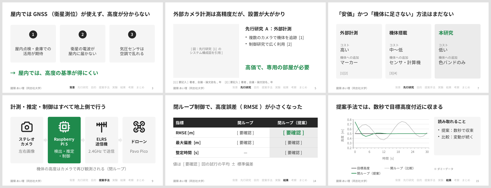

# research-slides

学会発表・論文発表・ゼミ発表用のスライドを、**伝わるデザインのルール**に沿って PowerPoint（.pptx）と PDF で作る Claude 用プラグインです。

「学会発表のスライド作って」「この論文をスライドにして」と頼むと、ヒアリング → 構成案 → 生成 → 見た目のチェックまでを Claude が行います。



完成例（PDF）：[`sample_uav_talk.pdf`](skills/research-slides/examples/sample_uav_talk.pdf)

## できること

- 論文・原稿・実験データから、発表用スライド（.pptx）と PDF を作る
- 各スライドに発表原稿（スピーカーノート）を入れる
- 先行研究・本研究の位置づけ・参考文献のスライドを含めた、論文発表向けの構成にする
- 生成したスライドを画像にして、はみ出しや強調の数をチェックする

## デザインのルール（抜粋）

| 項目 | ルール |
|---|---|
| 構成 | 本日の流れ → 背景 → 先行研究 → 目的・貢献 → 提案手法 → 実験 → 結果 → 考察 → まとめ → 参考文献 → 予備 |
| メッセージ | 1スライド1メッセージ。タイトルは「実験結果」ではなく主張文で書く |
| 強調 | アクセントカラーで強調するのは **1スライドにつき1箇所だけ** |
| 文字 | ゴシック体（メイリオ）、本文18pt以上、本文は最大5項目 |
| 色 | 白黒基調。色は重要な1箇所の緑だけ |
| 細部 | 枠線で囲まず面を敷く、表は横線のみ、余白でグループを示す、章ナビを表示 |
| アイコン | システム構成図など、分かりやすくなる場所にだけシンプルなアイコンを使う |
| 事実 | データにない数値は書かない。文献は実在を確認したものだけ引用する |

全ルールは [`skills/research-slides/references/guidelines.md`](skills/research-slides/references/guidelines.md) にあります。

## インストール

### Claude（Cowork・デスクトップアプリ）

このフォルダを zip にして拡張子を `.plugin` に変えたファイルを、Claude のチャットに添付して取り込みます。

### Claude Code

GitHub に置いた場合：

```
/plugin marketplace add <GitHubユーザー名>/research-slides
/plugin install research-slides@research-slides-marketplace
```

### プラグインを使わない場合

[`templates/CLAUDE.md`](templates/CLAUDE.md) を、スライドを作るフォルダ（リポジトリ）の直下に `CLAUDE.md` として置いても、同じルールで動きます。

## 使い方の例

```
来月の研究会（発表12分＋質疑3分）のスライドを作って。論文PDFを添付します。
```

```
このスライドを research-slides のルールでチェックして直して。
```

## 必要なもの

- Node.js と、`npm install pptxgenjs react react-dom react-icons sharp`（アイコンの描画に react-icons と sharp を使います）
- PDF への変換と見た目のチェックに LibreOffice（`soffice`）と `pdftoppm`（poppler）

## ファイル構成

```
research-slides/
├── .claude-plugin/
│   ├── plugin.json          # プラグインの定義
│   └── marketplace.json     # GitHub から配布するとき用
├── skills/research-slides/
│   ├── SKILL.md             # Claude への指示（要約ルールと手順）
│   ├── references/
│   │   └── guidelines.md    # 全ルール（詳細版）
│   ├── assets/
│   │   └── build_template.js  # pptxgenjs のひな形（サンプル発表）
│   └── examples/
│       ├── sample_uav_talk.pdf  # 完成例
│       └── preview.png          # README 用のプレビュー画像
├── templates/
│   └── CLAUDE.md            # プラグインなしで使う場合のルールファイル
└── README.md
```

## 参考にした資料

- 研究発表スライドのデザインに関するブログ記事（はてなブログ, 2025-10-13）
  https://kasei0730.hatenablog.com/entry/2025/10/13/182535
- キンコーズ・ジャパン「学会発表のスライドの作り方」
  https://www.kinkos.co.jp/column/conference-presentation-slides/
- スライドデザインの基本に関する note 記事（spicagraph）
  https://note.com/spicagraph/n/naf0de6e85929

## 作者

Airi Kokuryo
